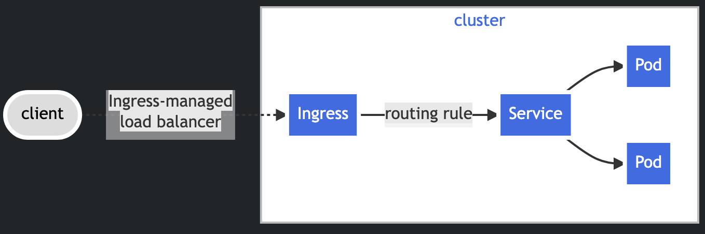

# Ingress

`Ingress` exposes HTTP and HTTPS routes from outside the cluster to services within the cluster. Traffic routing is controlled by rules defined on the `Ingress` resource.

Here is a simple example where an `Ingress` sends all its traffic to one `Service`:



You must have an `Ingress` controller to satisfy an `Ingress`. Only creating an Ingress resource has no effect. There are a number of [ingress controllers](https://kubernetes.io/docs/concepts/services-networking/ingress-controllers/) to choose from. For our tutorial we will be using [NGINX Ingress Controller for Kubernetes](https://www.nginx.com/products/nginx-ingress-controller/). It works with an NGINX webserver.

An `Ingress` needs `apiVersion`, `kind`, `metadata` and `spec` fields. The `Ingress` `spec` has all the information needed to configure a load balancer or proxy server. Most importantly, it contains a list of rules matched against all incoming requests. Ingress resource only supports rules for directing HTTP(S) traffic.

## Ingress rules

Each HTTP rule contains the following information:

- An optional host. If a host is provided (e.g. foo.bar.com), the rules apply to that host.
- A list of paths (e.g. `/`) each of which has an associated backend defined with a `service.name` and a `service.port.name` or `service.port.number`. Both the `host` and `path` must match the content of an incoming request before the load balancer directs traffic to the referenced `Service`.
- A backend is a combination of `Service` and port names. HTTP (and HTTPS) requests to the `Ingress` that match the `host` and `path` of the rule are sent to the listed backend.
---

Let's setup the `Ingress` now.

```bash
kubectl apply -f configurations/06_ingress/ingress.yaml
```

Verify the `Ingress`:

```bash
kubectl get ingress
```

The result looks like:

```
NAME   CLASS   HOSTS       ADDRESS   PORTS   AGE
web    nginx   web.local             80      23d
```

As mentioned earlier, the ingress object needs a controller to process traffic. Install the NGINX controller for `kind`:

```bash
kubectl apply -f https://raw.githubusercontent.com/kubernetes/ingress-nginx/main/deploy/static/provider/kind/deploy.yaml
```

After the controller is installed verify that the controller pods are running:

```bash
kubectl get pods -n ingress-nginx
```

You might see something like:

```
NAME                                       READY   STATUS    RESTARTS   AGE
ingress-nginx-controller-7b887fdf8-479gv   1/1     Running   0          4m26s
```

So when a request is made it will follow the path

```
Client -> Ingress Controller -> Ingress rule -> Service -> Pods
```
---

## Test the ingress

```bash
curl -H "Host: web.local" http://localhost
```

Test whether you were able to invoke the ingress. I got an error saying `curl: (7) Failed to connect to localhost port 80 after 0 ms: Couldn't connect to server`. It was expected because my `kind` node was not created with host port 80 mapped to the ingress controller. Let's test the `Ingress` through a temporary port-forward instead:

```bash
kubectl port-forward -n ingress-nginx service/ingress-nginx-controller 8080:80
```

> The NGINX controller created a pod `ingress-nginx-controller-7b887fdf8-479gv`. The pod name suggests that the default service name would be `ingress-nginx-controller`. This can be verified by executing `kubectl get services -n ingress-nginx`.

With the port forwarded we can now again send a request to `http://localhost:8080` and we will see:

```html
<html>
  <body>
    <h1>Hello from Kubernetes</h1>
    <p>This page comes from a ConfigMap.</p>
  </body>
</html>
```